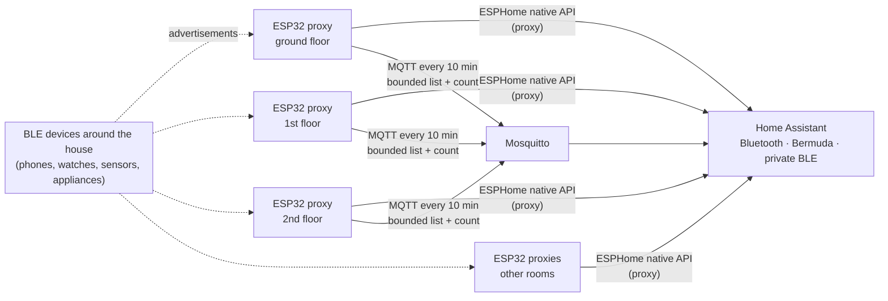

# ESP32 BLE Presence Network: Proxies, Room-Level Presence and a De-duplicating Scanner

**A whole-house Bluetooth Low Energy network built from ESPHome ESP32 boards. They act as passive BLE proxies for Home Assistant, feed room-level presence (Bermuda trilateration and private-BLE phone tracking), and run a custom on-device scanner that de-duplicates and counts nearby devices without flooding the HA database. Two firmware faults (a memory crash and MQTT disconnect cycling) were diagnosed and fixed.**

> **The short version:** ESP32 boards on each floor listen passively to BLE advertisements and forward them to HA. That gives coverage for BLE devices anywhere in the house, plus **room-level presence** from signal strength across several receivers. A custom scanner on the boards de-duplicates devices **on the ESP32** and publishes a bounded list and a count every 10 minutes, capturing **300+ distinct devices** over a few hours. Along the way:
> - an unbounded list **crashed a board** (fixed by capping it at 200)
> - a **15 s MQTT keepalive** caused disconnect cycling under BLE load (fixed at 60 s)

**Portfolio position:** Field level · wireless sensor network. Occupancy sensing is the input to demand-based control (DCV, optimum start, lighting). Related: [HA integration schedule](https://github.com/the-control-cabinet/home-assistant-integration-schedule)

---

## 1. Objective and scope

| Goal | How |
|---|---|
| BLE coverage for HA everywhere in the house | ESPHome Bluetooth proxies on multiple ESP32 boards |
| Room-level presence | Bermuda (RSSI trilateration across proxies); private BLE devices for phones/watches (resolvable private addresses) |
| Know what's around without bloating the database | On-device de-duplicating scanner → MQTT every 10 min |
| Reliability | Bounded memory; MQTT timeouts tuned to the load |

Out of scope: active connections to devices (beyond what HA's proxy does), and 3D spatial mapping (planned).

## 2. Architecture

| Layer | Detail |
|---|---|
| Receivers | **12 Bluetooth adapters in HA:** the HA host's own adapter plus ESPHome ESP32 proxies on each floor and in other rooms. Passive scanning: interval 320 ms, window 30 ms |
| HA | Bluetooth integration (12 adapters incl. the host), Bermuda, iBeacon, private BLE devices (4) |
| Scanner transport | MQTT (Mosquitto), topics `ble_scanner/<board>/count` and `…/all_devices` |

## 3. Room-level presence

- **Bermuda** compares each device's signal strength (RSSI) at every proxy and assigns the nearest area: room-level presence without cameras or PIR.
- **Private BLE devices:** modern phones and watches rotate their MAC address for privacy. HA's private-BLE integration uses the device's identity key to follow it anyway, so a person's phone or watch reliably gives presence.
- **Address types:** a sweep classified devices by address type (public vs random). Random addresses explain why naive MAC counting over-counts devices.

## 4. The de-duplicating scanner

**Problem:** forwarding every advertisement to HA as entities would flood the recorder; BLE devices advertise many times a second.

**Design:** do the work on the ESP32 ([YAML](config/ble-scanner-dedup.yaml)):
1. Each advertisement's MAC is added to an in-memory list **only if it's new** (de-duplicated on the device).
2. Every **10 minutes** the board publishes the list as JSON, `{"devices":[…]}`, plus a **count**, to MQTT. It isn't retained.
3. HA reads the count as a sensor, and the list as attributes ([sensor YAML](config/ha-mqtt-sensors.yaml)).

**Status:** the scanner runs on the proxy boards, and the **count** sensor is the dependable output.

**Result:** the scanner captured **300+ distinct devices** over hours, with a single small update every 10 minutes. The recorder excludes the high-churn BLE entities (RSSI and distance globs).

## 5. Issues dealt with

| # | Issue | Cause | Fix | Lesson |
|---|---|---|---|---|
| 1 | **Board crashing / rebooting** | The seen-device list grew without limit and exhausted RAM (busy areas see hundreds of random addresses) | **Bound the list to 200 entries**, dropping the earliest | Every buffer on an embedded device needs a bound |
| 2 | **MQTT disconnect cycling** | Keepalive 15 s was too short while the radio was busy scanning | **Keepalive 60 s** | Tune communication timeouts to the real load |
| 3 | List attributes not populating | HA's `json_attributes_topic` needs a **JSON object**, not a bare array; the attribute size limit was also investigated | Wrap as `{"devices":[…]}`; the count sensor is the dependable output | Read the consumer's format contract. The count sensor is in service; list attributes are yet to be confirmed working |
| 4 | Recorder growth | BLE RSSI/distance entities update constantly | Recorder exclude globs | Trend only what you'll use |
| 5 | Counting the same phone many times | Random/rotating addresses | Private BLE device tracking for known people; counts treated as "activity", not people | Know your data's limits |

## 6. Roadmap
- [ ] 3D spatial mapping with Bermuda (floor-aware).
- [ ] Feed room presence into the supervisory layer (#3): occupancy-based heating and lighting.
- [ ] Confirm whether the device-list attributes now populate; drop the list topic if the count is enough.
- [ ] Compare the custom scanner with HA's native Bluetooth advertisement monitor, and retire whichever is redundant.

## 7. Skills demonstrated

| Skill | Evidence |
|---|---|
| Wireless sensor network design | Multi-receiver BLE coverage, passive scan tuning |
| Occupancy sensing | RSSI-based room presence; private-address tracking |
| Embedded resource management | Bounded buffer fixed a memory crash |
| Comms tuning | MQTT keepalive fix |
| Data reduction at the edge | De-duplicate on device, publish every 10 min |
| Integration format contracts | JSON-object requirement for HA attributes |

📺 [The Control Cabinet on YouTube](https://www.youtube.com/channel/UC5Cupmz7vlfcodpCX7k8iuQ)

*Built and documented by James · part of [The Control Cabinet BMS portfolio](https://github.com/the-control-cabinet). MIT Licence.*
