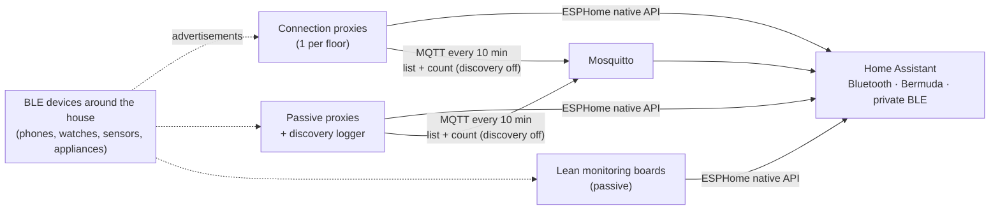

# ESP32 BLE Presence Network: Proxies, Room-Level Presence and a De-duplicating Scanner

**A whole-house Bluetooth Low Energy network of 11 ESPHome ESP32 boards with defined roles: one connection proxy per floor, passive proxies elsewhere, and lean monitoring boards. It feeds room-level presence (Bermuda trilateration and private-BLE phone tracking) and runs an on-device discovery logger that de-duplicates nearby devices without flooding the HA database. Includes a live fault investigation into watchdog resets on ESPHome 2026.10.0.**

> **The short version:** ESP32 boards in each room forward BLE advertisements to HA, giving coverage everywhere plus **room-level presence** from signal strength across receivers.
> - **Roles ([doc 01](docs/01-proxy-roles.md)):** one **connection proxy per floor**, passive proxies elsewhere, and **lean** plant/metering boards with no optional radio or MQTT work.
> - **Discovery logger ([doc 02](docs/02-scanner-v2.md)):** de-duplicates devices **on the ESP32** and publishes every 10 minutes. It captured **300+ distinct devices**; v2 cut the per-advertisement work to a single lookup.
> - **Faults fixed:** an unbounded list **crashed a board** (capped at 200); a **15 s MQTT keepalive** caused disconnect cycling (60 s).
> - **Open incident ([doc 03](docs/03-incident-esphome-2026-10-watchdog.md)):** task-watchdog resets on **ESPHome 2026.10.0**. Six hypotheses were eliminated one variable at a time, matched to upstream reports; **fix pending upstream**.

**Portfolio position:** Field level · wireless sensor network. Occupancy sensing is the input to demand-based control (DCV, optimum start, lighting). Related: [HA integration schedule](https://github.com/the-control-cabinet/home-assistant-integration-schedule)

---

## 1. Objective and scope

| Goal | How |
|---|---|
| BLE coverage for HA everywhere in the house | ESPHome Bluetooth proxies on multiple ESP32 boards |
| Room-level presence | Bermuda (RSSI trilateration across proxies); private BLE devices for phones/watches (resolvable private addresses) |
| Know what's around without bloating the database | On-device de-duplicating scanner → MQTT every 10 min |
| Reliability | Bounded memory; MQTT timeouts tuned to the load |

Out of scope: active connections to devices (beyond what HA's proxy does), and 3D spatial mapping (planned).

## Documents

| Doc | Contents |
|---|---|
| [01 Proxy roles](docs/01-proxy-roles.md) | One connection proxy per floor, passive proxies, lean monitoring boards; profiles and rules |
| [02 Discovery logger v2](docs/02-scanner-v2.md) | Purpose, vector → map rewrite, active scanning for names, HA side |
| [03 Incident: watchdog resets on ESPHome 2026.10.0](docs/03-incident-esphome-2026-10-watchdog.md) | Evidence, elimination table, upstream reports, status (open) |
| [04 Rename and clean-up runbook](docs/04-rename-and-cleanup-runbook.md) | Renaming boards: HA, Bermuda, MQTT, orphaned entities, recorder |
| [05 Calibration exercise (planned)](docs/05-calibration-exercise.md) | Survey, global ref_power and attenuation, per-receiver offsets, walk test, acceptance criteria |

## 2. Architecture

| Layer | Detail |
|---|---|
| Receivers | **12 Bluetooth adapters in HA:** the host's adapter plus 11 ESP32 proxies, with roles per [doc 01](docs/01-proxy-roles.md). Scan interval 320 ms, window 30 ms |
| HA | Bluetooth integration (12 adapters incl. the host), Bermuda, iBeacon, private BLE devices (4) |
| Scanner transport | MQTT (Mosquitto), topics `ble_scanner/<board>/count` and `…/all_devices` |

## 3. Room-level presence

- **Bermuda** compares each device's signal strength (RSSI) at every proxy and assigns the nearest area: room-level presence without cameras or PIR.
- **Private BLE devices:** modern phones and watches rotate their MAC address for privacy. HA's private-BLE integration uses the device's identity key to follow it anyway, so a person's phone or watch reliably gives presence.
- **Address types:** a sweep classified devices by address type (public vs random). Random addresses explain why naive MAC counting over-counts devices.

## 4. The de-duplicating scanner

**Problem:** forwarding every advertisement to HA as entities would flood the recorder; BLE devices advertise many times a second.

**Design:** do the work on the ESP32 ([YAML](config/ble-scanner-dedup.yaml), v2 in [doc 02](docs/02-scanner-v2.md)):
1. Each advertisement is checked against an in-memory map keyed by address. **Only new devices** are recorded, as type, address and name.
2. Every **10 minutes** the board publishes the list as JSON, `{"devices":[…]}`, plus a **count**, to MQTT. It isn't retained.
3. HA reads the count as a sensor, and the list as attributes ([sensor YAML](config/ha-mqtt-sensors.yaml)).

**Status:** the scanner runs on the proxy boards, and the **count** sensor is the dependable output.

**Result:** the scanner captured **300+ distinct devices** over hours, with a single small update every 10 minutes. The recorder excludes the high-churn BLE entities (RSSI and distance globs) and the list sensors (`sensor.ble_device_list*`).

## 5. Issues dealt with

| # | Issue | Cause | Fix | Lesson |
|---|---|---|---|---|
| 1 | **Board crashing / rebooting** | The seen-device list grew without limit and exhausted RAM (busy areas see hundreds of random addresses) | **Bound the list to 200 entries**, dropping the earliest | Every buffer on an embedded device needs a bound |
| 2 | **MQTT disconnect cycling** | Keepalive 15 s was too short while the radio was busy scanning | **Keepalive 60 s** | Tune communication timeouts to the real load |
| 3 | List attributes not populating | HA's `json_attributes_topic` needs a **JSON object**, not a bare array; the attribute size limit was also investigated | Wrap as `{"devices":[…]}`; the count sensor is the dependable output | Read the consumer's format contract. The count sensor is in service; list attributes are yet to be confirmed working |
| 4 | Recorder growth | BLE RSSI/distance entities update constantly | Recorder exclude globs | Trend only what you'll use |
| 5 | Counting the same phone many times | Random/rotating addresses | Private BLE device tracking for known people; counts treated as "activity", not people | Know your data's limits |
| 6 | Heavy per-advertisement scanner work | String building and a linear search on every advertisement | **v2:** map keyed by address; work only for new devices ([doc 02](docs/02-scanner-v2.md)) | Make the common case cheap |
| 7 | Duplicate entities via MQTT discovery | The scanner's MQTT connection also published discovery | `discovery: false`; MQTT removed from boards that don't need it | Use a transport only for what it's for |
| 8 | `//` comment broke compilation | ESPHome 2026.10 lambda emission | No `//` comments inside lambdas | Toolchain changes can change what's legal |
| 9 | **Watchdog resets (open)** | Matches upstream ESPHome 2026.10.0 reports | See [doc 03](docs/03-incident-esphome-2026-10-watchdog.md): fix pending | Instrument, one variable at a time, check upstream |

## 6. Roadmap
- [ ] **ESPHome fix for the watchdog resets:** update one board first, confirm uptime, then roll out ([doc 03](docs/03-incident-esphome-2026-10-watchdog.md)).
- [ ] Move the ground-floor connection role to the understairs plant board, after the fix.
- [ ] **Calibration exercise ([doc 05](docs/05-calibration-exercise.md)):** measure every receiver at 1 m against a fixed-power reference, set per-scanner offsets, fit attenuation, then a walk test against acceptance criteria. Never done so far: presence currently runs on defaults.
- [ ] 3D spatial mapping with Bermuda (floor-aware).
- [ ] Feed room presence into the supervisory layer (#3): occupancy-based heating and lighting.
- [ ] Confirm whether the device-list attributes now populate; drop the list topic if the count is enough.
- [ ] Compare the custom scanner with HA's native Bluetooth advertisement monitor, and retire whichever is redundant.

## 7. Skills demonstrated

| Skill | Evidence |
|---|---|
| Wireless sensor network design | Multi-receiver BLE coverage, passive scan tuning |
| Occupancy sensing | RSSI-based room presence; private-address tracking |
| Embedded resource management | Bounded buffer fixed a memory crash |
| Comms tuning | MQTT keepalive fix |
| Data reduction at the edge | De-duplicate on device, publish every 10 min |
| Integration format contracts | JSON-object requirement for HA attributes |
| Network role design | Connection, passive and lean profiles per floor |
| Structured fault investigation | Six hypotheses eliminated with instrumentation; upstream correlation |
| Change management | Rename runbook covering HA, Bermuda, MQTT and the recorder |
| Sensor commissioning (planned) | Receiver calibration against a reference, offsets, path-loss fit, walk-test acceptance ([doc 05](docs/05-calibration-exercise.md)) |

📺 [The Control Cabinet on YouTube](https://www.youtube.com/channel/UC5Cupmz7vlfcodpCX7k8iuQ)

*Built and documented by James · part of [The Control Cabinet BMS portfolio](https://github.com/the-control-cabinet). MIT Licence.*
